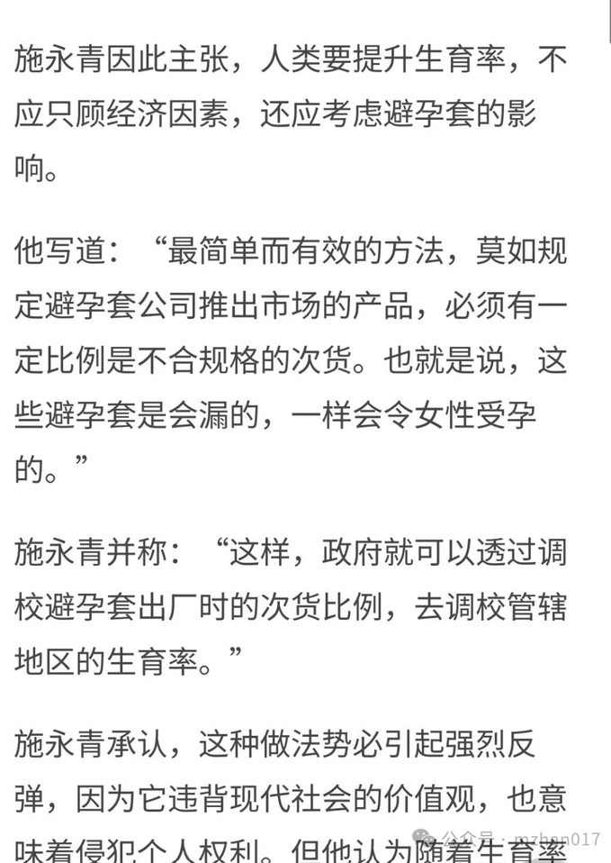

[[回到列表]](https://mzhan017.github.io/)
#  [杂谈] 网上对喷的正当理由是什么？
我对象经常说，你在网上和人喷什么？喷得自己都睡不着失眠就好了？ 
我是有正当理由的，他都要搞你了，你还能心平气和？我做不到： 
https://mp.weixin.qq.com/s/Y6dm3QTHMknGRXoQ_DbePQ#:~:text=%E6%88%91,%E4%B8%8D%E5%88%B0 

主要还是在知乎上和人对喷，比如下面一条： 

其实这个人说的不太对，所以我们就是要及时的纠正。如果这种错误的认知存在，整个环境就像是一个大水桶，决定水量的就是这个短板。 
再比如最近比较火的“随机套漏论”， 
这种人思维意识，我感觉严重的侵犯他人私生活的嫌疑，也可以说这个人是一肚肚坏水水： 

**脸都不要了**。 